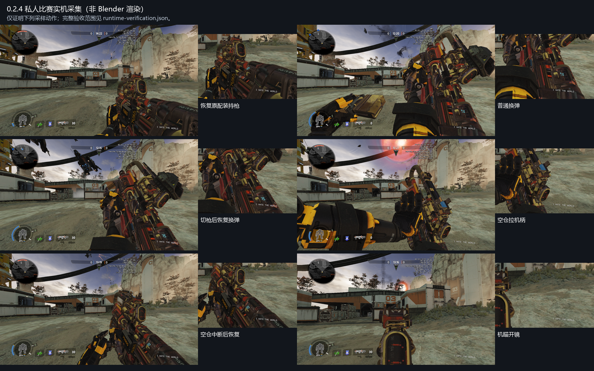

# Prowler.CAR.Scavenger

将 Apex 猎兽进化皮 Scavenger 移植到 Titanfall 2 / R2Vanilla 的 CAR。当前为 **0.2.4 预发布候选**，已经进行窗口模式私人比赛采样；完整视觉验收仍有覆盖边界。

- [下载安装包](https://github.com/ht1580/Prowler-CAR-Scavenger/releases/download/v0.2.4/Prowler.CAR.Scavenger-0.2.4.zip)
- [源码与生成的 SMD/QC](https://github.com/ht1580/Prowler-CAR-Scavenger/releases/download/v0.2.4/Prowler-Rebuild-Source-0.2.4.zip)
- [实机片段与验证数据](https://github.com/ht1580/Prowler-CAR-Scavenger/releases/download/v0.2.4/Prowler-Evidence-0.2.4.zip)
- [动画顺序核对](rebuild-zero/verification/0.2.4/动画顺序核对.md) · [逐索引映射](rebuild-zero/verification/0.2.4/animation-order-map.csv) · [实机范围](rebuild-zero/verification/0.2.4/runtime-verification.json)

## 本轮修正

- 参考 [HK560 马洛里安](https://thunderstore.io/c/northstar/p/HK560/Malorian_Arms_3516/)、[Creamy CAR](https://thunderstore.io/c/northstar/p/Creamy_jpg/CAR_Pastel_Perfection/) 和 [CNS144 R301](https://thunderstore.io/c/northstar/p/CNS144/Mythic_R301_apex_R201/) 的动画编码、序列表、骨架和 bodygroup 结构，未复制参考作品资产。
- 修正转换器为省略位移的增量轨道填入绑定位置的问题，以及验证工具掩盖 RAWPOS 的问题；显式编码偏移姿态、保持原版序列 DELTA 语义，转鼓枢轴零位移不靠放宽容差。
- 普通冲刺采用源原生右手动画，避免原先摆动轨迹把枪带到镜头后方。
- 外接 ProScreen 与 RUI 使用同一安装座和缩放；第一、第三人称安装位置统一。世界瞄具重新对齐，机瞄 bodygroup 换为猎兽原生后照门。
- 重新核对动画顺序：第一人称124个动画描述符、97个序列，第三人称4/4；索引、引用、activity、255条事件、flags和bbox保持原版。
- 修正换弹内容时序：整套手、枪、弹匣共同重采样；空仓插匣与后续枪机补弹阶段分别对齐。late1从完整段第34帧、空仓late2从第55帧恢复，避免直接套用语义不同的原生 late 片段。

27项回归检查及原生握持、机构/接触检查通过；最终MDL解码了968帧换弹，恢复段位置最大差0.00668模型单位。实机采样包含普通换弹、0发空仓换弹、切枪与切回恢复、持枪、射击、冲刺、蹲姿及开镜。未逐一录制所有单手/攀墙/战术组合，也没有公共对局的长时间共存测试；运行时具体late序列ID未直接读取。原有准星模组关闭原生UI3/UI4/UI7的设置保留。

## 安装与构建

退出游戏、备份旧同名模组，将安装包内 `Prowler.CAR.Scavenger` 文件夹完整替换到实际启动 profile 的 `mods` 目录。资源路径为原版 CAR 路径；避免同时启用另一套 CAR 模型替换。

本包不带CFG、DLL或生产NUT脚本，不改武器数值。骨架保留85根原版兼容骨，追加33根具有网格/父级用途的原生机构骨，世界模型14根。构建入口与工具/原始资产要求见 [rebuild-zero/README.md](rebuild-zero/README.md)。

0.2.0/0.2.1 的旧参考根骨解释已经被后续核对推翻，不应作为当前版本的修正依据；旧验证材料仅用于追溯。
