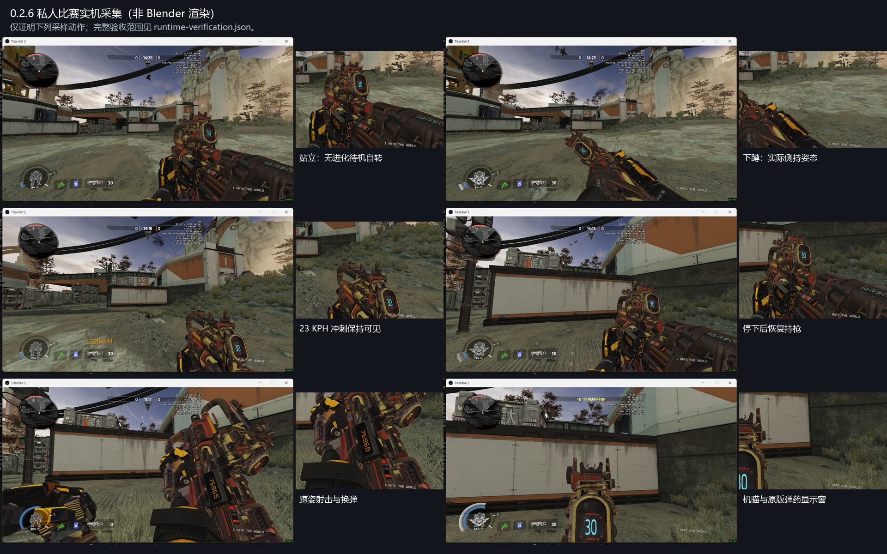

# Prowler.CAR.Scavenger

将 Apex 猎兽进化皮 Scavenger 移植到 Titanfall 2 / R2Vanilla 的 CAR。当前为 **0.2.6 预发布候选**，已在窗口模式私人比赛采样；完整视觉验收仍未完成。

- [下载安装包](https://github.com/ht1580/Prowler-CAR-Scavenger/releases/download/v0.2.6/Prowler.CAR.Scavenger-0.2.6.zip)
- [源码与 SMD/QC](https://github.com/ht1580/Prowler-CAR-Scavenger/releases/download/v0.2.6/Prowler-Rebuild-Source-0.2.6.zip)
- [实机片段、声音回录与验证数据](https://github.com/ht1580/Prowler-CAR-Scavenger/releases/download/v0.2.6/Prowler-Evidence-0.2.6.zip)
- [独立 RUI 文件](https://github.com/ht1580/Prowler-CAR-Scavenger/releases/download/v0.2.6/prowler_car101.rui) · [可编辑坐标预设](rebuild-zero/src/assets/prowler_ammo_panel.json)
- [运行时范围](rebuild-zero/verification/0.2.6/runtime-verification.json) · [动画索引映射](rebuild-zero/verification/0.2.6/animation-order-map.csv) · [逐骨骼用途](rebuild-zero/verification/0.2.6/bone-audit.csv)

## 本版修改

- 移除常驻进化待机层中的手臂运动和弹鼓自转。有效的非开火转鼓通道保持固定，进化机构运动仅在开火片段启用。
- 普通冲刺改回 Apex `sprint_0`，限制摆幅，并整体调整枪、附件和双手目标；实际 23 KPH 冲刺采样中枪体保持可见，停止后恢复持枪。
- 添加一个 CLIENT 蹲姿参数控制脚本。安静下蹲时出现固定侧持姿态，起身恢复；射击、换弹和快速移动时附加侧持平滑退出，随后恢复。该侧持取自原版 CAR 蹲姿相对偏移，不宣称是恢复出的 Apex 独立蹲姿动画。
- 停止事件（含消音停止变体）正确播放尾音，避免重启整段射击循环；移除错误替代低弹量提示的第三人称枪声，加入端点淡化与混音余量。18 秒系统输出回录无削波；主观爆音听感未最终验收，地图原版背景战斗音保留。
- 解出 Apex 原始 RMDL 的 22 个 UI 面板，按原版中央弹药显示区域的父骨骼和四角修正弹药 RUI。保留 TF2 数字绘制逻辑；外接 ProScreen 是单独的击杀计数屏。提供可编辑几何 RUI 与 JSON 坐标预设。

第一人称保留原 124 个动画描述符前缀，末尾增加两个蹲姿偏移，合计 126 个描述符、97 个序列；原活动、事件和标志保留。原三个姿态参数后增加 `prowler_crouch`，仅扩展既有 autoplay 混合网格。第三人称维持 4/4，255 条原版事件保留。骨架为原 85 根兼容骨加 33 根有网格或父级用途的机构骨，世界模型 14 根。

保留此前 DELTA 省略位移与 RAWPOS 读取修正，以及换弹完整段与 late1/late2 第 34/55 帧恢复修正。36 项回归检查通过，编译后 968 帧换弹核对通过。实机覆盖站立、蹲下/起身、冲刺/停止、蹲姿射击与正常换弹、机瞄和停止开火后的声音回录；未穷尽单手、攀墙、技能和全部动作中断组合，未进行公共服务器长期共存测试。

结构参考了 [HK560 马洛里安](https://thunderstore.io/c/northstar/p/HK560/Malorian_Arms_3516/)、[Creamy CAR](https://thunderstore.io/c/northstar/p/Creamy_jpg/CAR_Pastel_Perfection/) 和 [CNS144 R301](https://thunderstore.io/c/northstar/p/CNS144/Mythic_R301_apex_R201/)，未复制这些作品资产。

## 安装与构建

退出游戏、备份旧同名模组，将安装包中的 `Prowler.CAR.Scavenger` 文件夹完整替换到实际启动 profile 的 `mods` 目录。避免同时启用另一套 CAR 模型替换。

本包包含一个生产用途 CLIENT 蹲姿控制脚本，没有 CFG、DLL、可执行文件或诊断脚本；不修改既有 CFG 和武器数值。构建与原始资产要求见 [rebuild-zero/README.md](rebuild-zero/README.md)。

B 轮实测前 20 个安装文件与 ZIP 逐一相符。发布核对时本地模组目录已被外部移除，未重新安装或干扰后续游戏进程；此前运行时证据与当前安装状态分开记录。

旧版本验证材料保留用于追溯，不能代替本版的范围与限制。
