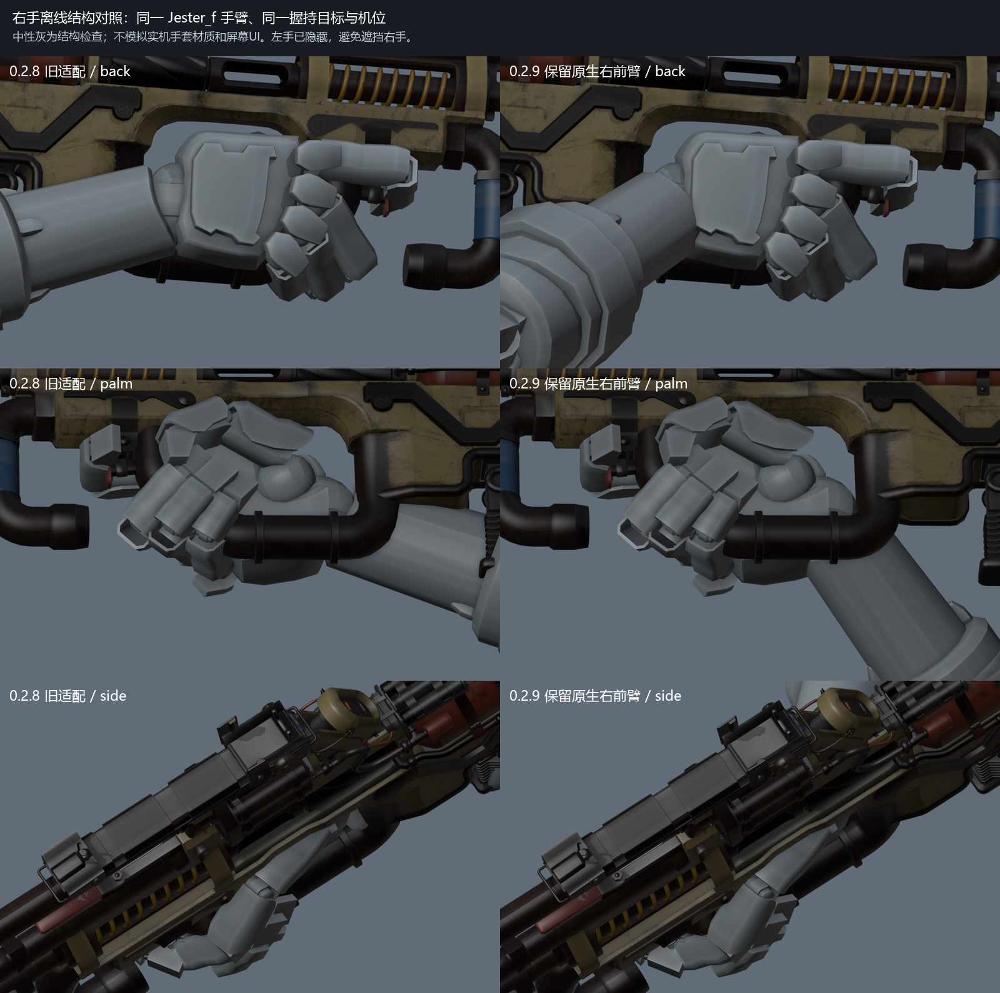

# Prowler.CAR.Scavenger

Apex 猎兽 Scavenger 替换 Titanfall 2 / R2Vanilla CAR。当前为 **0.2.9 右手修正候选**，已安装并重启进入窗口模式私人比赛复测；完整视觉接受仍等待实际效果对照。

- [下载安装包](https://github.com/ht1580/Prowler-CAR-Scavenger/releases/download/v0.2.9/Prowler.CAR.Scavenger-0.2.9.zip)
- [右手前后近景、实机视频与GIF](previews/0.2.9/README.md)
- [全部实机证据](https://github.com/ht1580/Prowler-CAR-Scavenger/releases/download/v0.2.9/Prowler-Evidence-0.2.9.zip)
- [源码与SMD/QC](https://github.com/ht1580/Prowler-CAR-Scavenger/releases/download/v0.2.9/Prowler-Rebuild-Source-0.2.9.zip)

## 右手修正

0.2.8保持了手腕相对枪的位置，却在适配中把右肘往枪身中线拉近、前臂拉直，改变了袖口与手掌附近的实际变形。仅凭握持坐标和一个局部手腕角度不能证明视觉正确。此前近景还受到左手遮挡，使用的stalker_m手臂也不同于这次直接从实机读取的Jester_f手臂。

0.2.9保留原生右肘、前臂、手腕和手指目标，仅调整上臂与锁骨以避开固定镜头，肘部辅助骨同步适配。改动应用到普通持枪、瞄准、跑步、换弹、收枪及单手切换。新近景单独显示实机查询确认的同款右手，灰色为离线结构检查，并非游戏手套材质。

54项单元检查及原动画索引/255条事件核对通过。源动作阶段对两套实际手臂网格的36个姿势检查，另对编译后全部80个绝对动画条目逐帧解码，共2476帧；右肘、前臂和手腕相对髋部的位置误差最大0.0112单位、角度误差最大0.0188度。968帧完整/分段换弹检查仍通过。这些结果与实际视觉接受分别记录。

最终D轮进程23868：客户端960x540窗口，私人Attrition/Forwardbase Kodai。实机读取预测第一人称代理模型为`models/weapons/arms/pov_pilot_light_jester_f.mdl`。14段603帧有效连续采样覆盖持枪、ADS、下蹲腰射/换弹、跑步/停止、空仓换弹、中断切回、切枪及技能输入。早期被控制台遮挡和输入失效的记录已排除。当前安装20个文件与下载ZIP一致，最终测试游戏已正常退出。

保留此前的右侧跑步、斜持蹲姿、每发一格且停火保持的弹鼓、低位外接击杀屏、支脚绕序和原贴图通道修复。第一人称133个动画描述符/98个序列，第三人称4/4；骨骼数量与0.2.8相同。

## 安装与范围

退出游戏，备份旧同名模组，将包内`Prowler.CAR.Scavenger`完整替换到实际启动profile的`mods`目录。包含一个生产用途CLIENT姿态控制脚本，不含CFG、DLL、可执行文件或诊断脚本。既有CFG源码、配装和武器数值保持原样。构建说明见[rebuild-zero/README.md](rebuild-zero/README.md)。

本版是针对已定位右手适配缺陷的候选，手掌和手指仍保持原生抓握目标，不能把数值检查当作用户视觉认可。未穷尽所有手套、技能及中断组合；本轮未重新回录声音，爆音听感、击杀累计和公共服务器长期共存仍有验收范围。[运行时报告](rebuild-zero/verification/0.2.9/runtime-verification.json) · [右前臂网格检查](rebuild-zero/verification/0.2.9/right-forearm-validation.json) · [编译动画检查](rebuild-zero/verification/0.2.9/compiled-dynamic-validation.json)

[0.2.8多视角旧版预览](previews/0.2.8/README.md)保留作历史对照，不作为右手已正确的证据。
