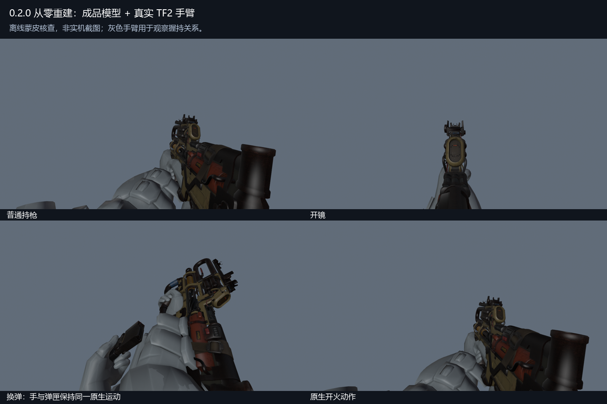

# Prowler.CAR.Scavenger

Titanfall 2 / Northstar 模组：将 Apex Legends 猎兽进化皮 Scavenger 移植到 CAR，包含模型、原生第一人称动作、机构运动、贴图与声音。

当前版本：**0.2.0 预发布版，从原始资源独立重建。离线检查通过，实机视觉验收尚未完成。**

- [下载安装包](https://github.com/ht1580/Prowler-CAR-Scavenger/releases/download/v0.2.0/Prowler.CAR.Scavenger-0.2.0.zip)
- [下载完整源码与生成的 SMD/QC](https://github.com/ht1580/Prowler-CAR-Scavenger/releases/download/v0.2.0/Prowler-Rebuild-Source-0.2.0.zip)
- [发布页及全部附件](https://github.com/ht1580/Prowler-CAR-Scavenger/releases/tag/v0.2.0)
- [重建记录与验收边界](rebuild-zero/verification/重建记录.md)

## 安装

1. 下载 `Prowler.CAR.Scavenger-0.2.0.zip`。
2. 退出游戏，备份已有同名模组，再将压缩包内的 `Prowler.CAR.Scavenger` 文件夹放入当前启动 profile 的 `mods` 目录。例如 `Titanfall2/R2Vanilla/mods/Prowler.CAR.Scavenger/mod.json`。
3. 避免同时启用其他替换 CAR 模型、材质或相同声音事件的模组。

本包只替换资源与武器模型路径，不修改用户 CFG、存档、武器数值或 FOV。Northstar/R2Vanilla 的实际兼容性与画面效果仍须在所用环境中确认。

## 0.2.0 重建内容

- 生产入口为 [`rebuild-zero/src/rebuild.ps1`](rebuild-zero/src/rebuild.ps1)，配置与工具要求见 [构建说明](rebuild-zero/README.md)。原始游戏资源及工具二进制需自行准备；本机路径需按环境修改。
- 第一人称保留原版 CAR 的 85 根兼容骨，追加 33 根有实际权重或必要父级用途的原生机构骨，共 118 根；转鼓使用独立原生枢轴。
- 重新适配原生拔枪、开镜、换弹、开火与待机动作；手、枪和弹匣共享原生时间采样。没有独立推移手腕来隐藏问题。
- 机构运动写入原有开火与待机描述符，不新增 `fire_layer`、姿态参数或生产客户端脚本。保留原版序列、事件与附件角色。
- 第三人称保留原版 14 根骨骼及 4 个序列，修正重建瞄具的三角面朝向；没有追加独立世界反应皮机构动画。
- 重新构建材质和音频；不发光。声音事件按实际音频库匹配。

8 项离线回归检查通过；成品开火与待机共 1,772 次原生双手/枪身姿态对照，最大位置误差约 0.006605 单位。详见 [验证数据](rebuild-zero/verification)。离线预览使用真实 TF2 手臂几何，**不是游戏截图**。

## 实机验证状态

初始候选资源曾在隔离 profile 中加载，但未取得可信持枪画面。禁用本模组的训练关基线也出现原版脚本 `SaveRecordedAnimation` 未定义错误，本地多人尝试未进入可验收场景。最终候选的连射、停火、跨姿态过渡与其他模组共存仍待实机确认。不能将资源加载日志或离线检查等同于实机通过。

## 仓库结构

`rebuild-zero/` 是 0.2.0 独立工程与核查资料。完整生成的 SMD/QC 随 Release 源码附件提供。根目录原有 `scripts/`、`mod_src/`、`tests/`、`docs/` 等保留为 0.1.x 历史工程，不是 0.2.0 构建入口。

## 致谢

模型、贴图及音效来自 Apex Legends 与 Titanfall 2，版权归 Respawn Entertainment / Electronic Arts 所有。本项目为非商业粉丝模组。

机制对照参考 [HK560 Malorian Arms 3516](https://thunderstore.io/c/northstar/p/HK560/Malorian_Arms_3516/)、[NachosChipeados Apex Legends Car](https://thunderstore.io/c/northstar/p/NachosChipeados/Apex_Legends_Car/)、[Echo_XI Apex Reactive R99 Model](https://thunderstore.io/c/northstar/p/Echo_XI/Apex_Reactive_R99_Model/)。未复制这些参考作品的模型、材质或音频。
