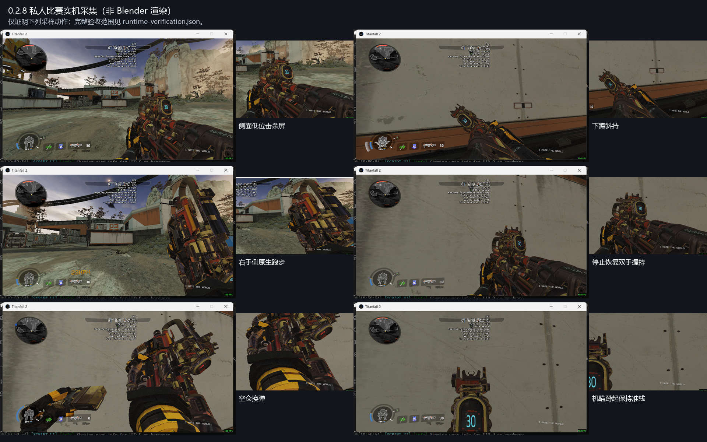

# Prowler.CAR.Scavenger

Apex 猎兽 Scavenger 替换 Titanfall 2 / R2Vanilla CAR。当前为 **0.2.8 测试候选**，最终包已重启加载，完成窗口模式私人比赛采样。

- [下载安装包](https://github.com/ht1580/Prowler-CAR-Scavenger/releases/download/v0.2.8/Prowler.CAR.Scavenger-0.2.8.zip)
- [源码与 SMD/QC](https://github.com/ht1580/Prowler-CAR-Scavenger/releases/download/v0.2.8/Prowler-Rebuild-Source-0.2.8.zip)
- [连续实机片段与验证数据](https://github.com/ht1580/Prowler-CAR-Scavenger/releases/download/v0.2.8/Prowler-Evidence-0.2.8.zip)
- [实机范围](rebuild-zero/verification/0.2.8/runtime-verification.json) · [全部绝对动画检查](rebuild-zero/verification/0.2.8/compiled-dynamic-validation.json) · [动画索引](rebuild-zero/verification/0.2.8/animation-order-map.csv)

## 本版修改

- 修正上版误用左手跑步变体，使用完整原生右手 `sprint_onehanded_0`，枪保持在右侧。跑步掏枪和收枪保留原生出入画动作；普通跑步结束恢复双手握持，单手分支独立。
- 外接击杀计数器下移贴合枪身，两个短支脚连在固定枪身上。正确轴向为 Y 高度、Z 前方：安装位从 `(1.047551,49.6,7)` 改为 `(1.047551,47,11)`，下移2.6、实际前移4。上版把增加Y误称前移，现已纠正。
- 修正第一/第三人称新增支脚24个面的反向绕序，保留原生枪身26733面和弹匣2082面。恢复基础色RGBA与彩色ILM通道，保留七张贴图及不透明、不发光材质。
- 修正蹲姿恢复动画中瞄准分支误用腰射基准；保留真正的蹲起过渡用途。清理绝对风动层残留的旧CAR屏幕坐标，纠正原生增量动画来源标记。
- 保留斜持蹲姿、每发一格弹鼓、停火保持、原版弹药RUI及既有换弹/声音事件修正。

51项单元测试、原动画索引与255条事件检查通过。对全部80个绝对动画条目（含参考帧）逐帧解码，共2476帧，另核对968帧完整/分段换弹。第一人称133个动画描述符/98个序列，第三人称4/4。原85根兼容骨加33根有实际用途的机构骨，未追加新骨骼。

最终B包20个安装文件与ZIP逐字节核对。实机连续画面覆盖右侧跑步/停止、下蹲腰射/换弹、ADS蹲起、空仓换弹、中断后切回及手动换弹、开阔处跑步切枪与翻越。窗口采样中未见弹鼓飞离、额外整片外壳消失或贴图闪烁。原模型开放机械空隙仍保留，完整视觉验收范围见运行时报告。

## 安装与范围

退出游戏，备份旧同名模组，把包内 `Prowler.CAR.Scavenger` 文件夹完整替换到实际启动 profile 的 `mods` 目录。包含一个生产用途CLIENT姿态控制脚本，不含CFG、DLL、可执行文件或诊断脚本。既有CFG未作源码编辑，武器数值和配装保持原样。构建要求见 [rebuild-zero/README.md](rebuild-zero/README.md)。

尚未穷尽所有技能、单手和中断组合；未验证击杀累计变化或公共服务器长期共存，本轮未重新回录声音，主观爆音听感仍未最终验收。60度步距由编译相位和控制逻辑核对，没有声称直接读取引擎角度。

结构参考 [HK560 马洛里安](https://thunderstore.io/c/northstar/p/HK560/Malorian_Arms_3516/)、[Creamy CAR](https://thunderstore.io/c/northstar/p/Creamy_jpg/CAR_Pastel_Perfection/)、[CNS144 R301](https://thunderstore.io/c/northstar/p/CNS144/Mythic_R301_apex_R201/)，未复制这些作品的资产。
