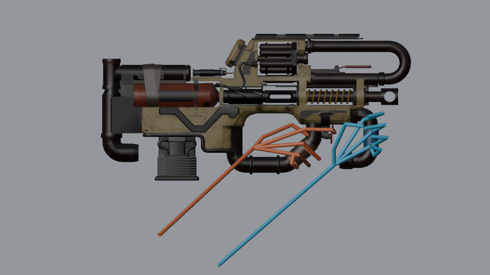
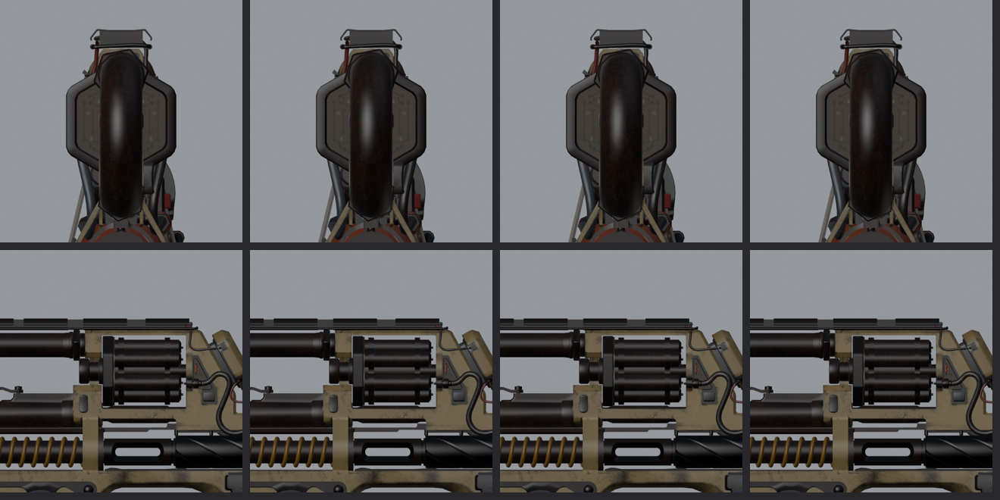

# Prowler.CAR.Scavenger

Titanfall 2 / Northstar 模组：把 Apex Legends 猎兽（Prowler）的进化皮「Scavenger」移植到 CAR 冲锋枪上，包括第一人称原生动画、开枪时转动的线圈转鼓、发光线圈和全自动猎兽枪声。

A Titanfall 2 Northstar mod that ports the Apex Legends Prowler reactive skin "Scavenger" onto the CAR SMG, with native first-person animations, a coil drum that turns on every shot, emissive coils and the full-auto Prowler fire sound.

> 当前版本 **0.1.17**：已构建并通过数据核对，第一人称已用游戏真实手臂模型在 Blender 中模拟，**尚未游戏内实测**。下载见 [Releases](../../releases)。

## 安装

1. 从 Releases 下载 `Prowler.CAR.Scavenger-0.1.17.zip`。
2. 解压出 `Prowler.CAR.Scavenger` 文件夹，放进当前启动 profile 的 `mods` 目录，例如 `Titanfall2\R2Vanilla\mods\Prowler.CAR.Scavenger\mod.json`。
3. 只替换 CAR 的模型、材质和声音；准星、FOV、开镜和 UI 沿用原版数值。`LoadPriority` 为 0，`RequiredOnClient` 为 false。

ConVar：`prowler_car_fx 0` 关闭线圈电弧特效。

## 仓库结构

| 目录 | 内容 |
|---|---|
| `mod_src/` | 模组本体源文件：`mod.json`、武器 keyvalues、客户端脚本、音频覆盖定义（WAV 由 `build_audio.py` 生成，见 Release 包） |
| `scripts/` | 完整构建链：Blender 生成视角/世界模型 SMD 与 QC → StudioMDL → MDLShit（v53 + RUI）→ 序列/索引修正 → RePak；以及原生姿态解码、转鼓检查、Blender 绑定工程与渲染 |
| `tests/` | 回归测试（音频事件名与路由、动画序列表、原生姿态根骨、第三人称握持） |
| `docs/` | 版本说明、交接说明、预览图 |

构建入口是 `scripts/build_all.ps1 -Version x.y.z`。脚本里的工具和素材路径（Blender、SFM StudioMDL、MDLShit、解包的 Apex/TF2 资源）是作者本机路径，仓库不包含任何解包的游戏原始素材，需要自行准备。

## 技术要点

- **转鼓：** 旋转写进射击增量动画（每帧 120°，每发整圈），和枪栓后坐一起播放；构建时解码最终 MDL 的全部动画，检查转鼓零件只绕自身轴转动（`check_drum_seat.py`）。
- **骨骼：** 按 HK560 教程合并骨架，移植枪骨骼挂在 `weapon_bone` 下，增量动画补齐新骨骼，所有骨骼声明 `$bonemerge`，序列表与原版一致。
- **声音：** Northstar 音频覆盖按事件名区分大小写匹配，必须使用音频库里的小写名称并覆盖全部变体。

## 致谢与声明

- 猎兽模型、贴图和声音来自 *Apex Legends*，CAR 及游戏资源来自 *Titanfall 2*，版权归 Respawn Entertainment / Electronic Arts 所有。本项目为非商业粉丝模组。
- 骨骼合并与动画流程参考 HK560 的 [Titanfall2AnimationModTutorial](https://github.com/HK560/Titanfall2AnimationModTutorial)。
- 音频事件清单参考 [rwynx/Northstar-Commands-and-Audio-Overriding](https://github.com/rwynx/Northstar-Commands-and-Audio-Overriding)，覆盖规则参考 [NorthstarLauncher](https://github.com/R2Northstar/NorthstarLauncher)。
- 工具：Blender + Blender Source Tools、Crowbar、Source Filmmaker StudioMDL、MDLShit、RePak、LegionPlus。
