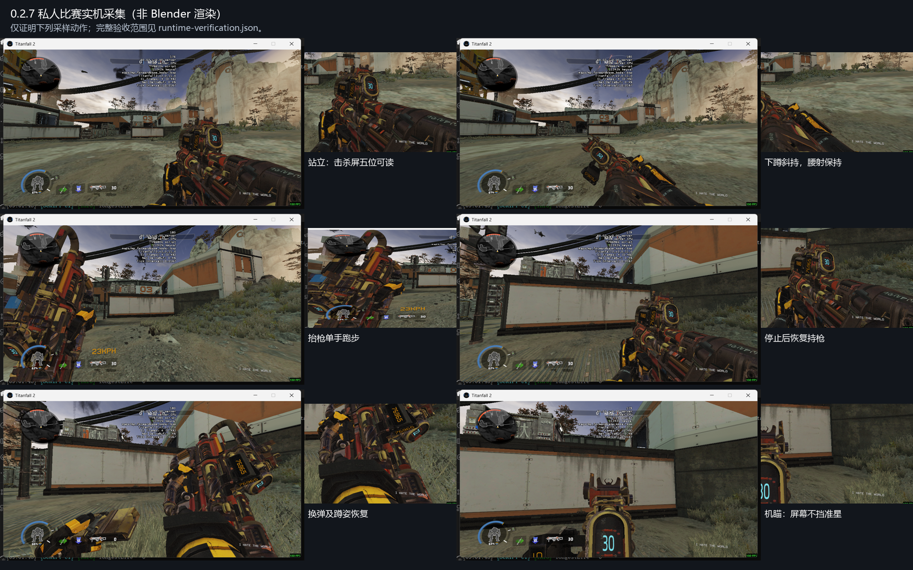

# Prowler.CAR.Scavenger

Apex 猎兽进化皮 Scavenger → Titanfall 2 / R2Vanilla CAR。当前为 **0.2.7 测试候选**，已安装并进行窗口模式私人比赛采样，完整视觉验收仍有覆盖边界。

- [下载安装包](https://github.com/ht1580/Prowler-CAR-Scavenger/releases/download/v0.2.7/Prowler.CAR.Scavenger-0.2.7.zip)
- [源码与 SMD/QC](https://github.com/ht1580/Prowler-CAR-Scavenger/releases/download/v0.2.7/Prowler-Rebuild-Source-0.2.7.zip)
- [实机片段与验证数据](https://github.com/ht1580/Prowler-CAR-Scavenger/releases/download/v0.2.7/Prowler-Evidence-0.2.7.zip)
- [实机范围](rebuild-zero/verification/0.2.7/runtime-verification.json) · [动画索引](rebuild-zero/verification/0.2.7/animation-order-map.csv) · [骨骼用途](rebuild-zero/verification/0.2.7/bone-audit.csv)

## 本轮五处修改

- 跑步按恶灵/烟妹的抬枪单手方向，使用完整原生 `sprint_althand_anim_0`，包含空闲手动作，停止后恢复。角色与玩家设置已分别解出核对；没有声称移植两名角色的完整动画选择状态机。
- 下蹲明显斜持，腰射时保持斜持。换弹及快速移动时附加斜持平滑退出，结束后恢复；机瞄保持中性。
- 六弹舱弹鼓每发推进一格（60°），停止后保持定位；换弹增加弹药不会触发转动。原生多圈开火轨道已改为中性，由独立相位参数驱动。
- 外接 ProScreen 击杀屏前移 2 单位，两个小支脚连接固定枪身；第一、第三人称与 RUI 使用同一安装位。最终采样完整显示五位数字，机瞄没有挡住准星。独立射线检查覆盖画布四角和中心，拒绝原生弹药窗遮挡。
- 支援手与扳机手分别求解肩部位置，避免左手够枪时把右肩一起推向前。持枪右腕弯曲由约 40° 降到 25°，枪、手腕及手指原生接触目标保持。

42 项回归检查、编译后机构/握持与 968 帧换弹检查通过。最终 C 轮实机覆盖站立、斜持蹲姿、冲刺/停止、机瞄、两次单发（30→29→28）、蹲姿射击/换弹及恢复。早期失败候选没有发布：首轮相位层导致枪模消失，后续试位仍遮挡计数器，均被实机或遮挡检查拒绝。

第一人称保留原 124 个动画描述符和 97 个序列前缀，追加两个蹲姿偏移、七个弹鼓相位及一个相位序列，合计 133/98；姿态参数原三个后追加两个。第三人称 4/4，255 条原版事件保留。原 85 根兼容骨加 33 根有实际用途的机构骨，世界模型 14 根。

保留此前 DELTA/RAWPOS、换弹第 34/55 帧恢复、原版弹药 RUI 区域及声音事件修正。结构参考 [HK560 马洛里安](https://thunderstore.io/c/northstar/p/HK560/Malorian_Arms_3516/)、[Creamy CAR](https://thunderstore.io/c/northstar/p/Creamy_jpg/CAR_Pastel_Perfection/)、[CNS144 R301](https://thunderstore.io/c/northstar/p/CNS144/Mythic_R301_apex_R201/)，未复制这些作品资产。

## 安装与边界

退出游戏、备份旧同名模组，把包内 `Prowler.CAR.Scavenger` 文件夹完整替换到实际启动 profile 的 `mods` 目录，避免同时启用另一套 CAR 模型替换。本包含一个生产用途 CLIENT 姿态控制脚本，不含 CFG、DLL、可执行文件或诊断脚本，不改武器数值与既有 CFG。构建与原始资产要求见 [rebuild-zero/README.md](rebuild-zero/README.md)。

未直接读取引擎姿态参数或逐帧测量实机转角：60° 步距由编译后的索引姿态和驱动逻辑核对，实机记录单发与停止行为。未穷尽单手、攀墙、技能和所有中断组合；没有公共服务器长期共存测试。本轮没有重新回录声音，主观爆音听感仍未最终验收。
