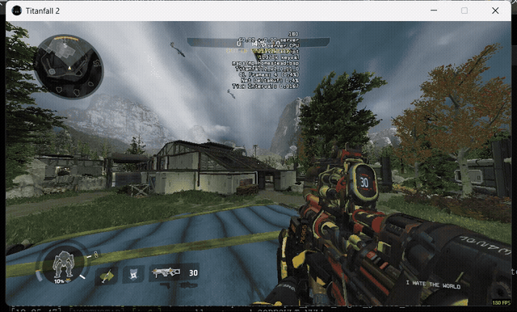
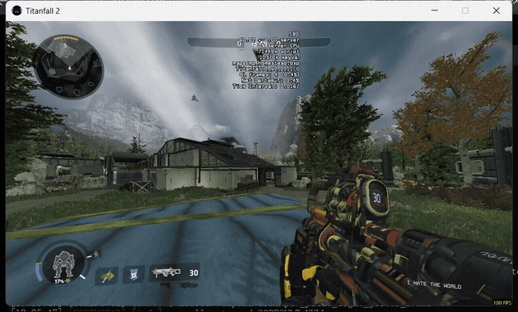
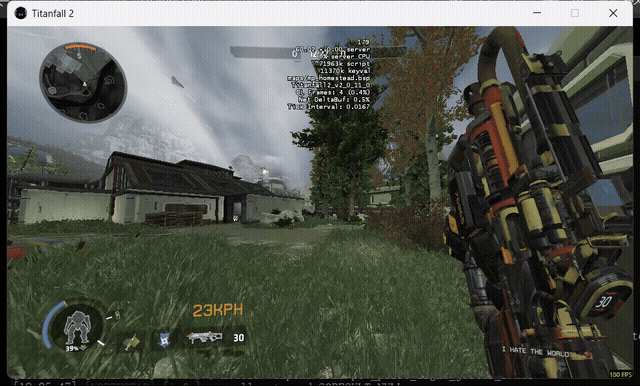
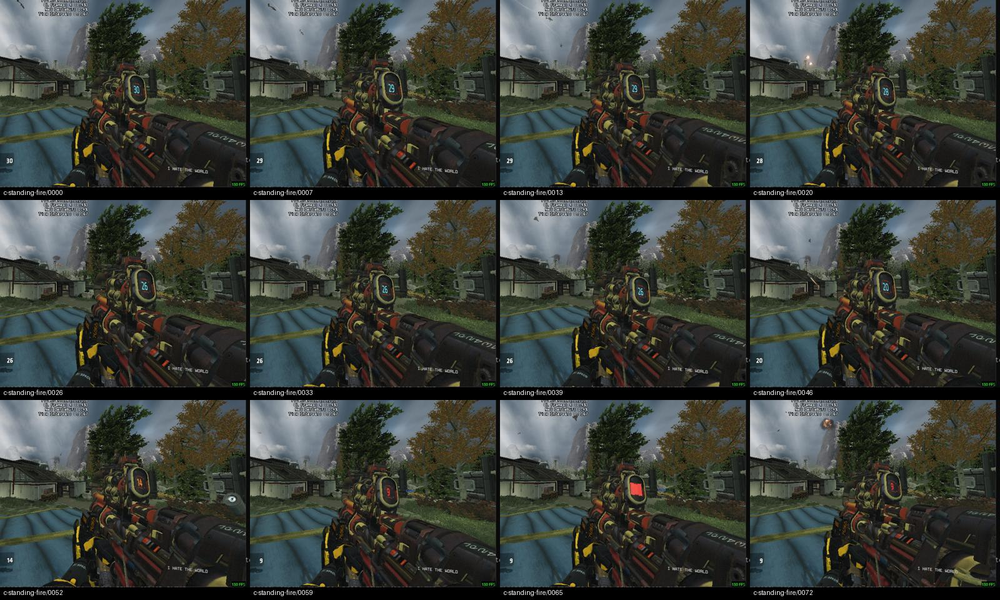
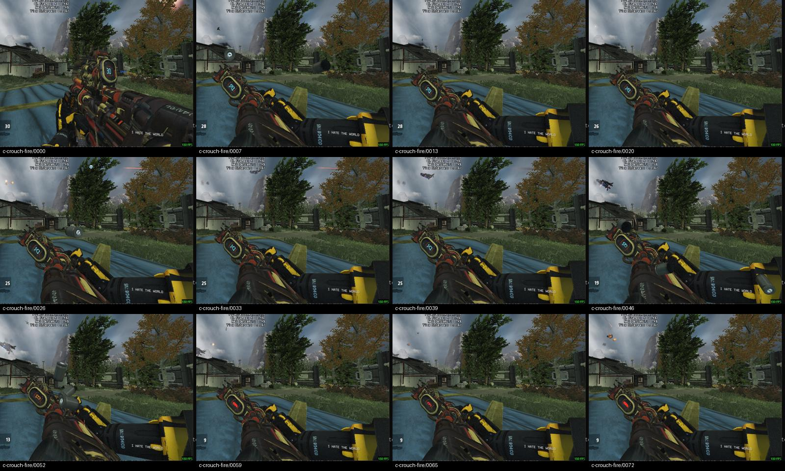
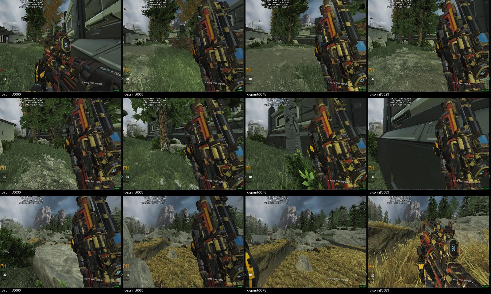

# 0.2.10 开火、蹲姿与跑步实机

最终C轮，进程41260；960x540窗口，私人Homestead/Attrition，实际Jester_f手臂。14段653帧，按采集时间戳编码；无音轨。视频和GIF仅对应这一安装包。旧版baselineA及因分辨率切换崩溃的B轮不作本版验收证据。

本版改为中性端点的原生_0开火片段，修正蹲姿与开火层混合时的接触丢失。58项单元检查，源动作及编译后分别2100个混合接触采样；这些数值不能替代用户对右手外观的判断。

## 找到的原生跑步片段

| 片段 | 检查结果与当前用途 |
| --- | --- |
| sprint_onehanded_0 | 右手持枪、枪口抬起的小幅循环；当前普通/单手冲刺循环来源 |
| sprint_0 / sprint_heavy_0 | 较大幅度往复摆动；原样转换时部分时段枪身退出固定视野，未直接采用 |
| sprint_althand_anim_0 / heavy | 左手对应动作，不能直接当右手跑步 |
| sprint_althand_seq_0 / heavy | 两帧站立基准，不是完整跑步循环 |
| sprintdraw / sprintholster / sprintraise / sprintslide | 出入跑步和滑铲分支；不能拿一段退出动作当循环 |

尚未确认恶灵/烟妹的完整动画选择图。用户关于“跑步大部分不是举起”的姿势偏好仍待澄清；当前沿用此前右侧举枪要求，没有把侧移、碰撞或停止状态强制改成冲刺。

## 连续录像

- [standing-fire.mp4](https://github.com/ht1580/Prowler-CAR-Scavenger/releases/download/v0.2.10/standing-fire.mp4)
- [crouch-fire.mp4](https://github.com/ht1580/Prowler-CAR-Scavenger/releases/download/v0.2.10/crouch-fire.mp4)
- [ads-fire.mp4](https://github.com/ht1580/Prowler-CAR-Scavenger/releases/download/v0.2.10/ads-fire.mp4)
- [ads-crouch-fire.mp4](https://github.com/ht1580/Prowler-CAR-Scavenger/releases/download/v0.2.10/ads-crouch-fire.mp4)
- [sprint.mp4](https://github.com/ht1580/Prowler-CAR-Scavenger/releases/download/v0.2.10/sprint.mp4)
- [crouch-exit.mp4](https://github.com/ht1580/Prowler-CAR-Scavenger/releases/download/v0.2.10/crouch-exit.mp4)
- [reload.mp4](https://github.com/ht1580/Prowler-CAR-Scavenger/releases/download/v0.2.10/reload.mp4)
- [stand-recover.mp4](https://github.com/ht1580/Prowler-CAR-Scavenger/releases/download/v0.2.10/stand-recover.mp4)
- [stop.mp4](https://github.com/ht1580/Prowler-CAR-Scavenger/releases/download/v0.2.10/stop.mp4)
- [final-idle.mp4](https://github.com/ht1580/Prowler-CAR-Scavenger/releases/download/v0.2.10/final-idle.mp4)
- [standing.mp4](https://github.com/ht1580/Prowler-CAR-Scavenger/releases/download/v0.2.10/standing.mp4)
- [crouch.mp4](https://github.com/ht1580/Prowler-CAR-Scavenger/releases/download/v0.2.10/crouch.mp4)
- [reload-before-run.mp4](https://github.com/ht1580/Prowler-CAR-Scavenger/releases/download/v0.2.10/reload-before-run.mp4)
- [step-right.mp4](https://github.com/ht1580/Prowler-CAR-Scavenger/releases/download/v0.2.10/step-right.mp4)

## 动作抽帧

完整范围、失败尝试与限制见[运行时报告](../../rebuild-zero/verification/0.2.10/runtime-verification.json)。这仍是修正候选，未标为完整视觉通过。
