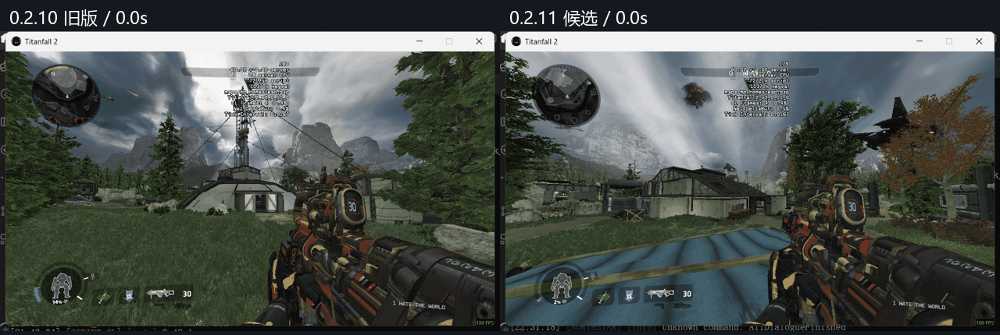
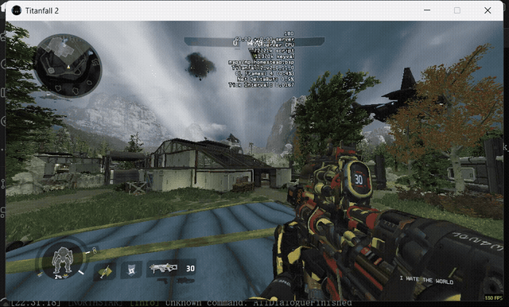
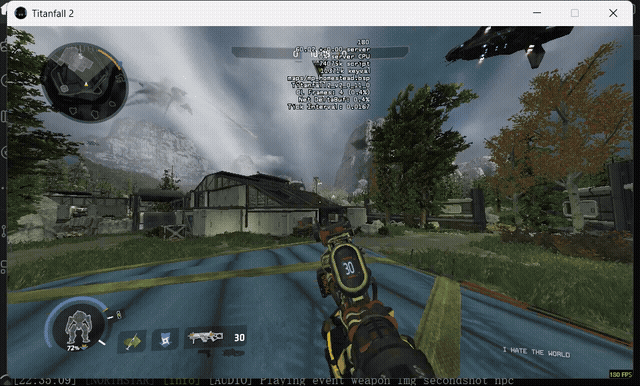
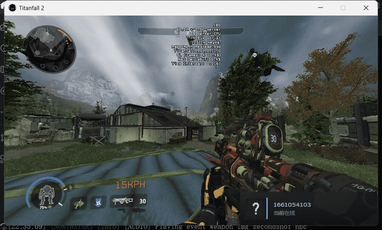
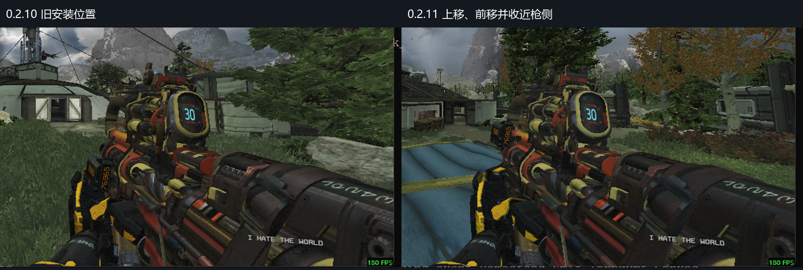

# 0.2.11 声音与动态修正实机

最终D轮，进程74592；960×540窗口，私人Homestead/Attrition，实际Jester_f手臂。最终录像对应安装包SHA256 56301a14c80f5f8b1d9ab1b0708104d70da1e8bba319115287f4fb8f73dc1ce7。A轮0.2.10只作旧版对照，B/C中间诊断不作为本版模型验收证据。

## 带声音的录像

- [0.2.11 点射、连射与普通换弹](https://github.com/ht1580/Prowler-CAR-Scavenger/releases/download/v0.2.11/fire-reload-with-audio.mp4)
- [0.2.11 空仓换弹](https://github.com/ht1580/Prowler-CAR-Scavenger/releases/download/v0.2.11/empty-reload-with-audio.mp4)
- [0.2.10 旧版声音对照](https://github.com/ht1580/Prowler-CAR-Scavenger/releases/download/v0.2.11/baseline-0.2.10-with-audio.mp4)

来自各自同次游戏的系统输出回放录音，没有录制物理麦克风，没有后期增益。画面与录音按共享单调时钟裁齐；声卡驱动延迟未校准。最终两段录音削波计数为0。旧版与新版场景环境声不完全相同，不能当耳边声压测量。

## 动态对比

同一输入时间表，不同出生位置与镜头，不能作逐像素对齐对比。新版斜持绕视线25度旋转并保持前后深度，避免长枪尾在过渡时扫入镜头。

## 外接击杀屏

上移1.5、前移3并收近枪侧，缩短两处连接支架。图为实际游戏截图裁剪；原生中央弹药屏保留。装备pro_screen已确认，本轮没有重新累计击杀验收数字增长。

## 最终D轮连续录像

以下MP4保留采集时间间隔，未带音轨；有声片段见上方。

- [ads-strafe-fire.mp4](https://github.com/ht1580/Prowler-CAR-Scavenger/releases/download/v0.2.11/ads-strafe-fire.mp4)
- [air-duck.mp4](https://github.com/ht1580/Prowler-CAR-Scavenger/releases/download/v0.2.11/air-duck.mp4)
- [before-ads-reload.mp4](https://github.com/ht1580/Prowler-CAR-Scavenger/releases/download/v0.2.11/before-ads-reload.mp4)
- [crouch-ads-fire.mp4](https://github.com/ht1580/Prowler-CAR-Scavenger/releases/download/v0.2.11/crouch-ads-fire.mp4)
- [crouch-fire.mp4](https://github.com/ht1580/Prowler-CAR-Scavenger/releases/download/v0.2.11/crouch-fire.mp4)
- [crouch-reload.mp4](https://github.com/ht1580/Prowler-CAR-Scavenger/releases/download/v0.2.11/crouch-reload.mp4)
- [empty-reload.mp4](https://github.com/ht1580/Prowler-CAR-Scavenger/releases/download/v0.2.11/empty-reload.mp4)
- [final-idle.mp4](https://github.com/ht1580/Prowler-CAR-Scavenger/releases/download/v0.2.11/final-idle.mp4)
- [fire-reload.mp4](https://github.com/ht1580/Prowler-CAR-Scavenger/releases/download/v0.2.11/fire-reload.mp4)
- [post-ads-reload.mp4](https://github.com/ht1580/Prowler-CAR-Scavenger/releases/download/v0.2.11/post-ads-reload.mp4)
- [side-step.mp4](https://github.com/ht1580/Prowler-CAR-Scavenger/releases/download/v0.2.11/side-step.mp4)
- [sprint.mp4](https://github.com/ht1580/Prowler-CAR-Scavenger/releases/download/v0.2.11/sprint.mp4)
- [standing.mp4](https://github.com/ht1580/Prowler-CAR-Scavenger/releases/download/v0.2.11/standing.mp4)
- [stop.mp4](https://github.com/ht1580/Prowler-CAR-Scavenger/releases/download/v0.2.11/stop.mp4)
- [strafe-fire.mp4](https://github.com/ht1580/Prowler-CAR-Scavenger/releases/download/v0.2.11/strafe-fire.mp4)

65项单元检查通过，编译后362帧移动/跳落/regrip及164帧攻击共16,832个接触采样；没有新增骨骼，原动画表前缀与255条事件保持。公共分支统一驱动枪与双手，开火降低视觉反馈并去掉作者引入的视线轴左滚；CAR弹道后坐力和武器数值保留。

这是修正候选。数值、日志和有限录像不能替代用户对握持、枪声及换弹手感的判断；所有手套/瞄具/技能组合尚未穷尽。

[修正记录](../../rebuild-zero/verification/0.2.11/重建记录.md) · [运行时范围](../../rebuild-zero/verification/0.2.11/runtime-verification.json) · [音频输出核对](../../rebuild-zero/verification/0.2.11/audio-output-verification.json)
