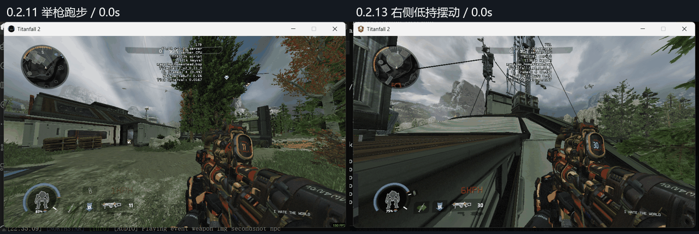
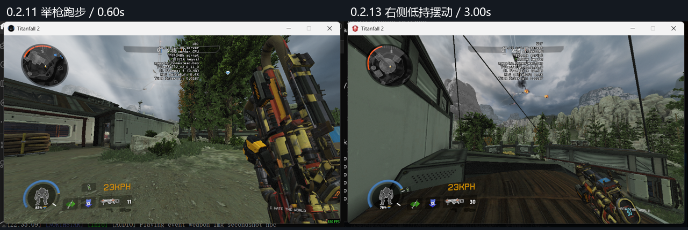
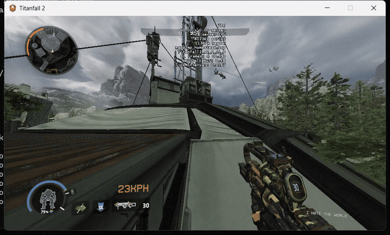
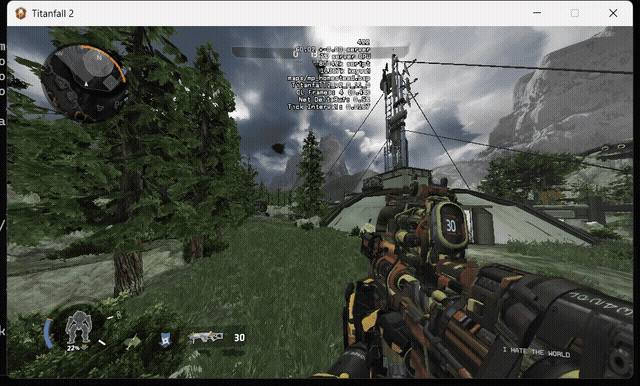
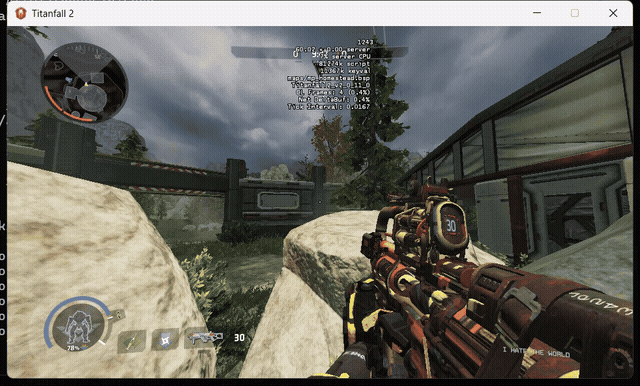

# 0.2.13 右侧低持跑步

按用户确认，普通跑步改为Apex常见的低持摆动。原生sprint_0节奏适配TF2固定镜头：20%位移、25%旋转摆幅，整体前移6单位；手和枪保持同一低持握点。特殊onehanded动作保留独立分支。没有宣称复原恶灵/烟妹完整角色动画选择图。

最终A轮，进程70828，R2Vanilla，960×540窗口私人Homestead/Attrition。12段773帧，对应ZIP d2df975a8eeda6547eac7e0cef529cc3519a4c73dec55fa8159c5673686a720a。0.2.12中间候选及其菜单误录不作为本版证据。

## 新旧跑姿

左侧为0.2.11既有实机，右侧为本次0.2.13实机。场地路线和录制时刻不同，不是逐像素对齐比较。

## 连续动作

此GIF为field-sprint前4秒；完整6秒MP4保留屋顶、落地及近障碍过程。

以下视频均无音轨，按实际采集时间编码。音频、世界模型、材质和姿态控制器与0.2.11逐字节一致；[0.2.11有声试听](../0.2.11/README.md)保留。

- [ads-fire.mp4](https://github.com/ht1580/Prowler-CAR-Scavenger/releases/download/v0.2.13/ads-fire.mp4)
- [air-duck.mp4](https://github.com/ht1580/Prowler-CAR-Scavenger/releases/download/v0.2.13/air-duck.mp4)
- [crouch-fire.mp4](https://github.com/ht1580/Prowler-CAR-Scavenger/releases/download/v0.2.13/crouch-fire.mp4)
- [field-sprint.mp4](https://github.com/ht1580/Prowler-CAR-Scavenger/releases/download/v0.2.13/field-sprint.mp4)
- [field-stop.mp4](https://github.com/ht1580/Prowler-CAR-Scavenger/releases/download/v0.2.13/field-stop.mp4)
- [final-idle.mp4](https://github.com/ht1580/Prowler-CAR-Scavenger/releases/download/v0.2.13/final-idle.mp4)
- [reload.mp4](https://github.com/ht1580/Prowler-CAR-Scavenger/releases/download/v0.2.13/reload.mp4)
- [reload-after-ads.mp4](https://github.com/ht1580/Prowler-CAR-Scavenger/releases/download/v0.2.13/reload-after-ads.mp4)
- [run-fire.mp4](https://github.com/ht1580/Prowler-CAR-Scavenger/releases/download/v0.2.13/run-fire.mp4)
- [run-stop.mp4](https://github.com/ht1580/Prowler-CAR-Scavenger/releases/download/v0.2.13/run-stop.mp4)
- [standing.mp4](https://github.com/ht1580/Prowler-CAR-Scavenger/releases/download/v0.2.13/standing.mp4)
- [stop.mp4](https://github.com/ht1580/Prowler-CAR-Scavenger/releases/download/v0.2.13/stop.mp4)

69项单元检查通过，另核对198个编译后根/镜头轨迹采样；编译后完整21帧低持循环在保守70度水平视角下，最少32.95%的枪身顶点在画面内，既有25%门槛保持。源/编译后全动作、枪手接触、循环接缝、进入/退出跑步端点、255条原事件及原序列前缀继续核对。此几何统计不能替代实机外观判断。

普通低持循环没有枪身绕到左侧，所录停止/开火/换弹能恢复对应动作。近墙和落地仍由原游戏状态机选择动作；未把所有移动强制成冲刺。

这是修正候选，摆动手感和手部外观仍待用户复核。未穷尽所有手套、瞄具、技能、快速中断和公共服务器长期测试。

[实机范围](../../rebuild-zero/verification/0.2.13/runtime-verification.json) · [全部循环帧](../../rebuild-zero/verification/0.2.13/compiled-low-sprint-validation.json) · [修正记录](../../rebuild-zero/verification/0.2.13/重建记录.md)
