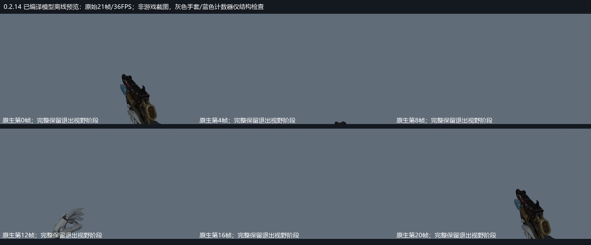

# 0.2.14 完整Apex循环离线预览

**本轮未完成实机视觉验收。** 游戏在原配置、独立profile和独立启动目录均显示白屏；没有将白屏或旧版本录像当作本版通过证据。一次白屏下跳图诊断出现engine.dll崩溃，原因未定位。新Skin/Camo归零保护的实际游戏效果尚未验证。

以下来自本版已编译MDL、解码后的完整21帧循环及实际TF2 Jester_f手臂，**不是游戏录像**。Workbench显示原始基础色、灰色手套与蓝色计数器壳作结构检查，不模拟游戏光照或RUI文字，不用来证明迷彩机制生效。

[下载36FPS离线MP4](https://github.com/ht1580/Prowler-CAR-Scavenger/releases/download/v0.2.14/native-sprint-offline.mp4)

按用户要求，普通sprint_0完整保留21帧、36FPS的枪和双手轨迹，包括退出视野下沿的阶段。此前0.2.13保留20%位移/25%旋转并固定初始握点，本版去掉该适配。特殊onehanded分支保持独立；未宣称还原恶灵/烟妹完整角色动画选择图。根/镜头原始轨迹、CAR过渡事件时序和武器数值保持。

72项源与编译检查通过；新增核对原生完整位置/旋转和编译后FPS。两MDL各9档皮肤表全部相同，主材质均指向原始猎兽Scavenger；新增本地CAR和第一人称实体Skin/Camo归零保护，保留保存的配装和其他武器/手套。材质表正确不等于运行时迷彩已经验收。

[原生轨迹检查](../../rebuild-zero/verification/0.2.14/native-sprint-validation.json) · [固定外观实现范围](../../rebuild-zero/verification/0.2.14/fixed-appearance-validation.json) · [本轮验证边界](../../rebuild-zero/verification/0.2.14/runtime-verification.json)
