# 0.2.8 多视角与动态预览

> 用户随后反馈0.2.8右手仍不自然。此处手部近景受到左手遮挡，不能作为右手绑定正确的证据。[0.2.9右手修正对照](../0.2.9/README.md)。

[下载全部原图、MP4与GIF](https://github.com/ht1580/Prowler-CAR-Scavenger/releases/download/v0.2.8/Prowler-Previews-0.2.8.zip)

**实机与离线预览分别标注。** 离线图来自最终0.2.8已编译模型，使用基础色贴图；灰色手臂用于查看绑定，计数器只显示外壳，不模拟游戏UI或完整材质。实机图和14段视频来自窗口模式私人比赛，未录制音轨。

## 360度离线旋转

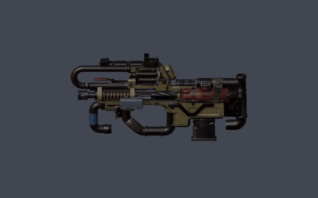

[旋转MP4](https://github.com/ht1580/Prowler-CAR-Scavenger/releases/download/v0.2.8/preview-model-turntable.mp4)

## 枪模各方向（离线）

| 视角 | 视角 |
|---|---|
| 计数器侧 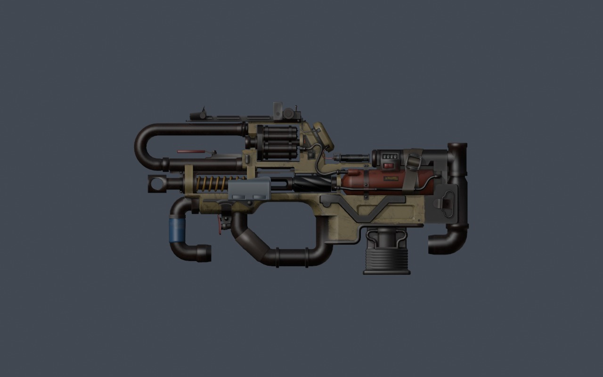 | 另一侧 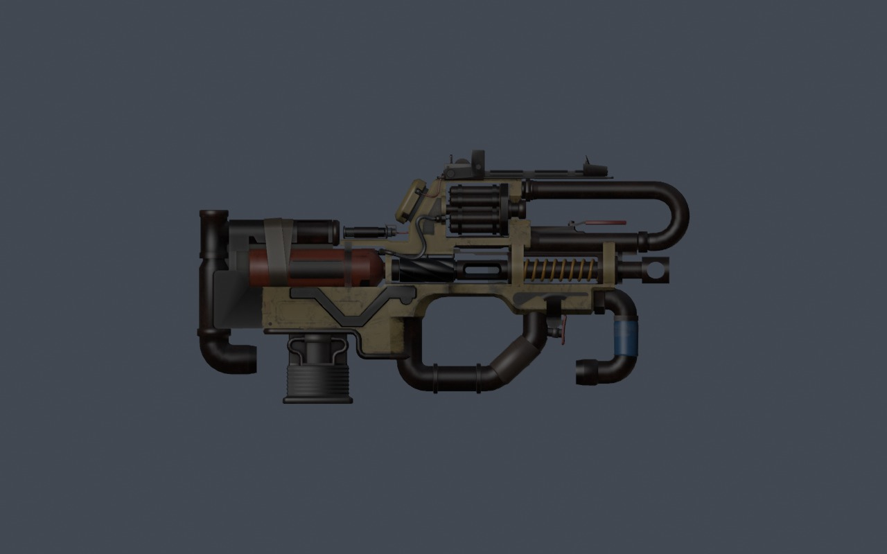 |
| 枪口方向 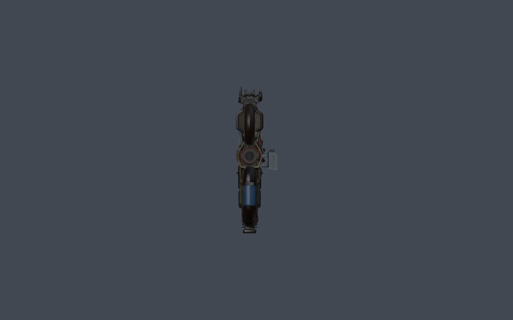 | 枪托方向 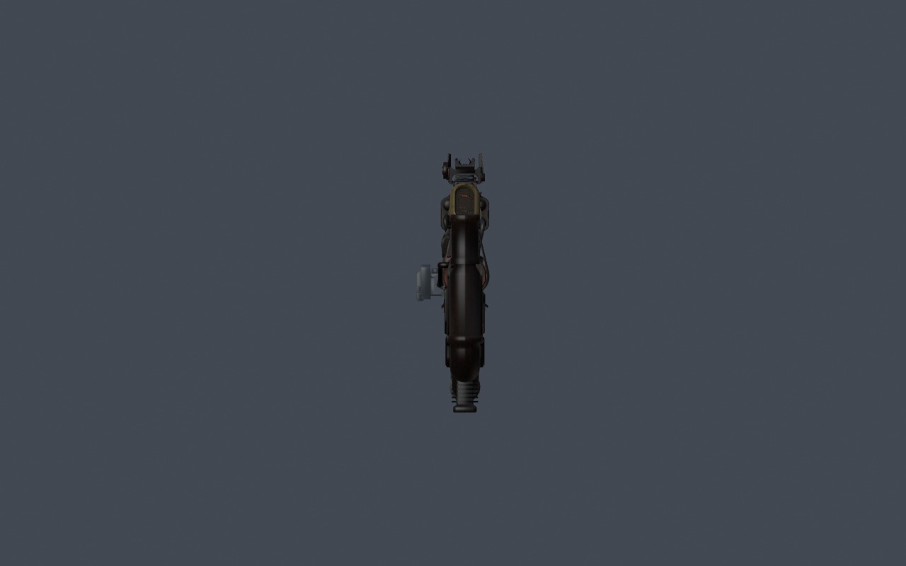 |
| 俯视 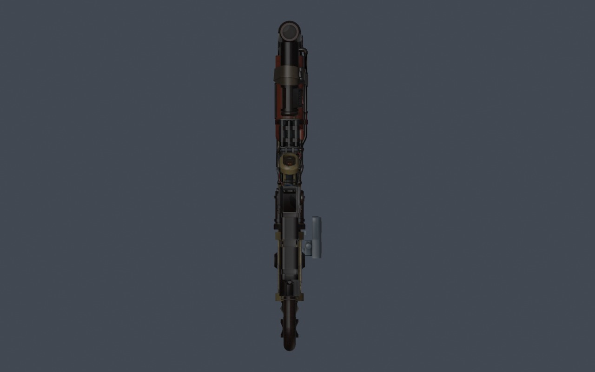 | 仰视 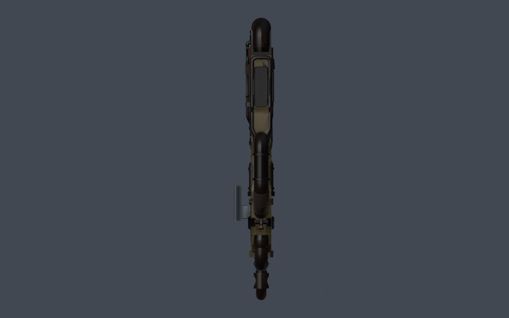 |
| 前侧斜视 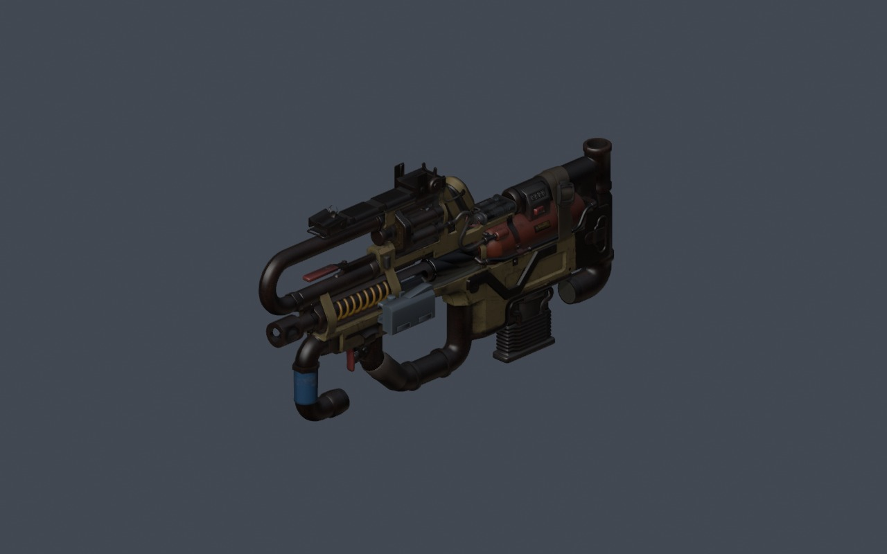 | 后侧斜视 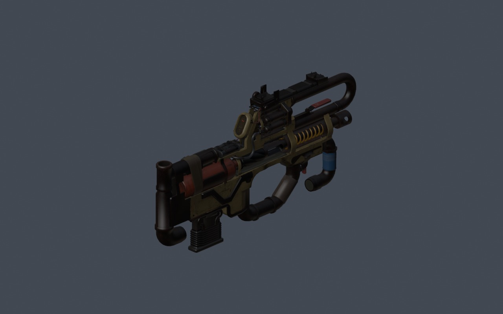 |

## 手部近景（离线中性灰手臂）

**右手侧面**
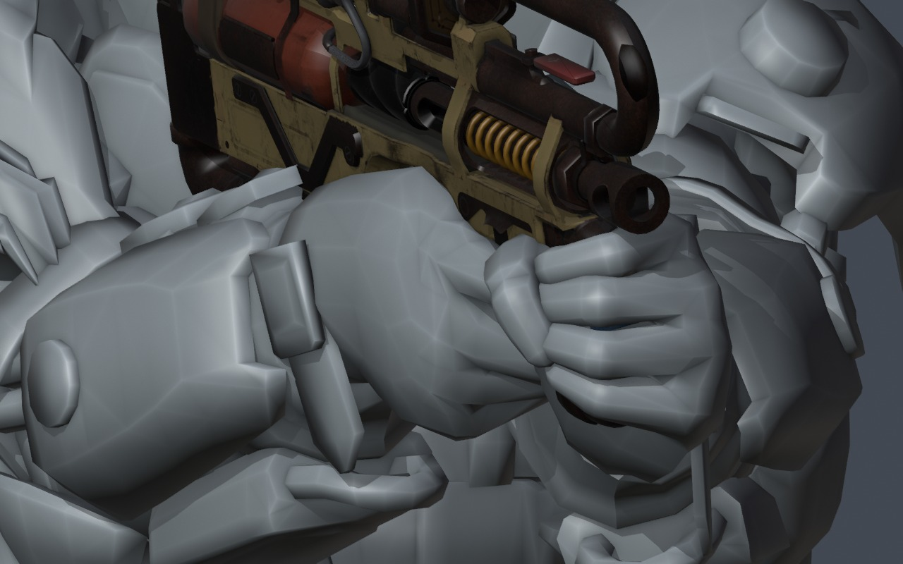

**右手背面**
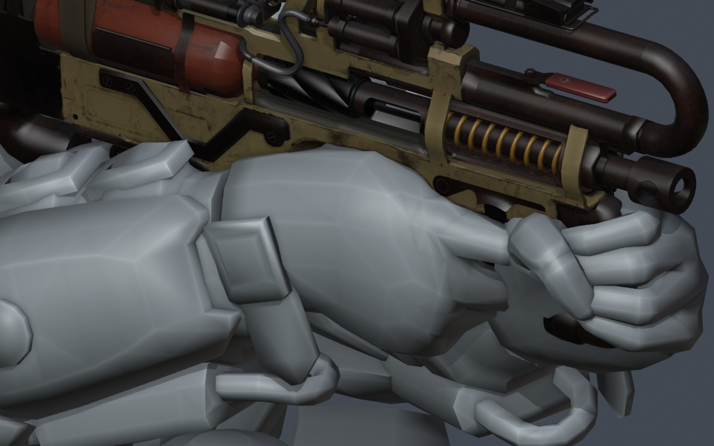

**右手内侧**
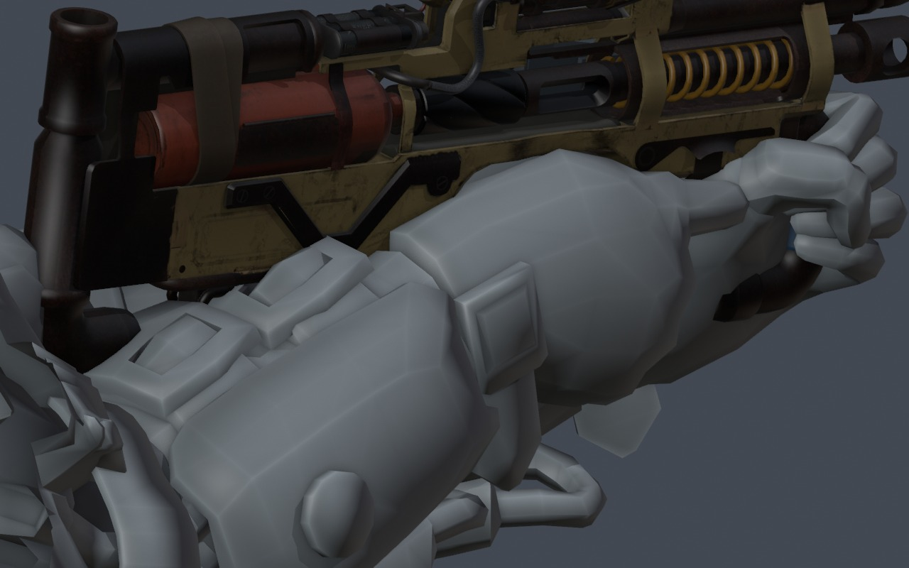

## 窗口实机截图

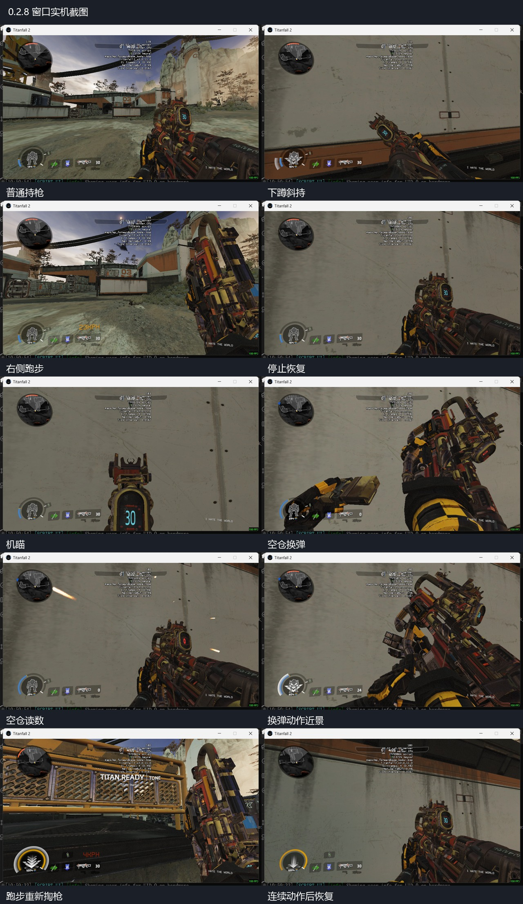

## 动态GIF（实机）

右侧跑步：

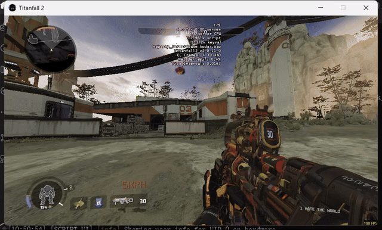

跑步收枪、重新掏枪及随后翻越：

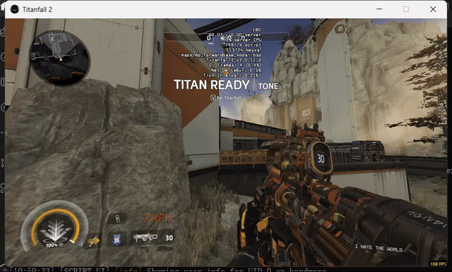

## 全部实机MP4

| 动作 | 视频 |
|---|---|
| 普通持枪 | [打开 / 下载MP4](https://github.com/ht1580/Prowler-CAR-Scavenger/releases/download/v0.2.8/preview-game-standing.mp4) |
| 下蹲 | [打开 / 下载MP4](https://github.com/ht1580/Prowler-CAR-Scavenger/releases/download/v0.2.8/preview-game-crouch.mp4) |
| 右侧跑步 | [打开 / 下载MP4](https://github.com/ht1580/Prowler-CAR-Scavenger/releases/download/v0.2.8/preview-game-sprint.mp4) |
| 停止恢复 | [打开 / 下载MP4](https://github.com/ht1580/Prowler-CAR-Scavenger/releases/download/v0.2.8/preview-game-stop.mp4) |
| 下蹲腰射与换弹 | [打开 / 下载MP4](https://github.com/ht1580/Prowler-CAR-Scavenger/releases/download/v0.2.8/preview-game-crouch-fire-reload.mp4) |
| 瞄准蹲起 | [打开 / 下载MP4](https://github.com/ht1580/Prowler-CAR-Scavenger/releases/download/v0.2.8/preview-game-ads-crouch-exit.mp4) |
| 空仓换弹 | [打开 / 下载MP4](https://github.com/ht1580/Prowler-CAR-Scavenger/releases/download/v0.2.8/preview-game-empty-reload.mp4) |
| 中断换弹后切回 | [打开 / 下载MP4](https://github.com/ht1580/Prowler-CAR-Scavenger/releases/download/v0.2.8/preview-game-interrupt-reload.mp4) |
| 补充换弹 | [打开 / 下载MP4](https://github.com/ht1580/Prowler-CAR-Scavenger/releases/download/v0.2.8/preview-game-resume-manual.mp4) |
| 动作后静止 | [打开 / 下载MP4](https://github.com/ht1580/Prowler-CAR-Scavenger/releases/download/v0.2.8/preview-game-idle-after.mp4) |
| 开阔处跑步切枪与翻越 | [打开 / 下载MP4](https://github.com/ht1580/Prowler-CAR-Scavenger/releases/download/v0.2.8/preview-game-run-equip-open.mp4) |
| 连续动作后恢复 | [打开 / 下载MP4](https://github.com/ht1580/Prowler-CAR-Scavenger/releases/download/v0.2.8/preview-game-stop-open.mp4) |
| 跳跃输入采样 | [打开 / 下载MP4](https://github.com/ht1580/Prowler-CAR-Scavenger/releases/download/v0.2.8/preview-game-jump.mp4) |
| 技能输入采样 | [打开 / 下载MP4](https://github.com/ht1580/Prowler-CAR-Scavenger/releases/download/v0.2.8/preview-game-tactical.mp4) |

[版本与安装包](../../README.md) · [实机检查范围](../../rebuild-zero/verification/0.2.8/runtime-verification.json)

截图不等同于全部状态验收；跳跃和技能片段只说明该次输入采样。原模型机械开孔保留，完整说明见实机检查范围。
