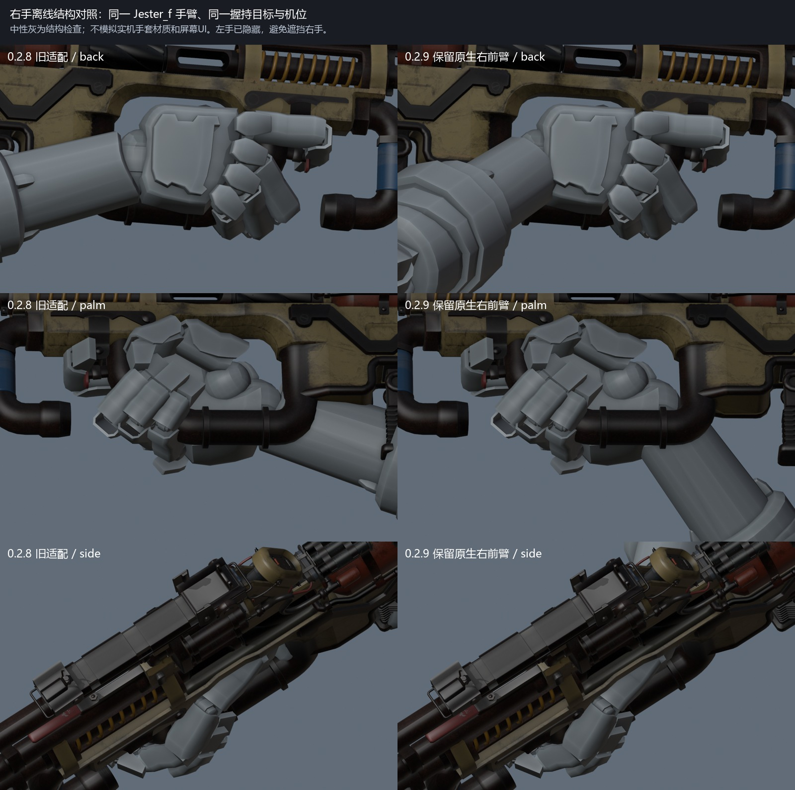
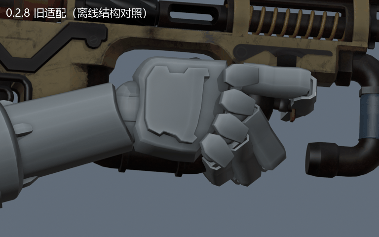
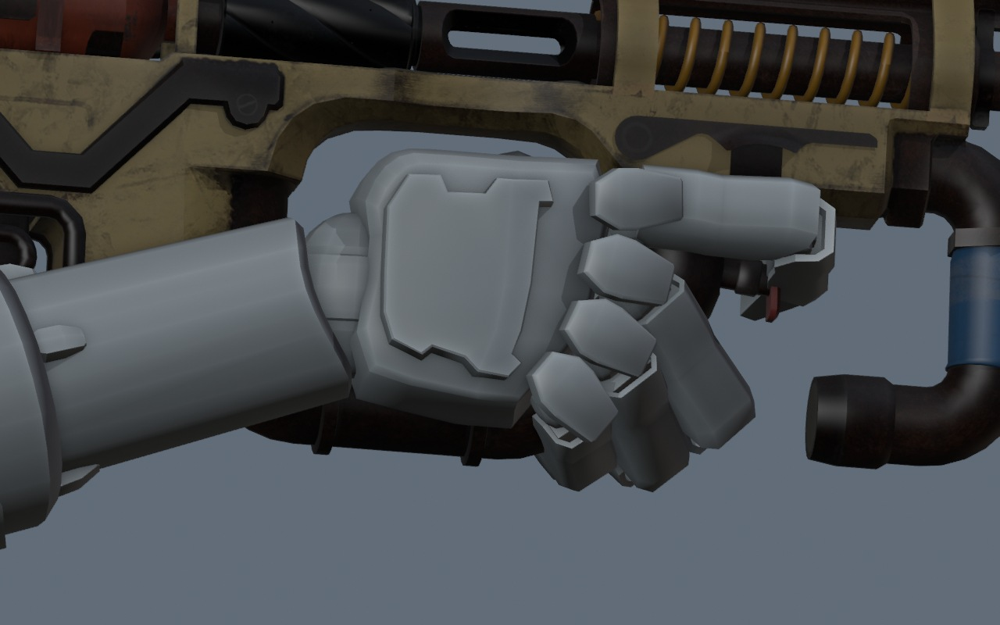
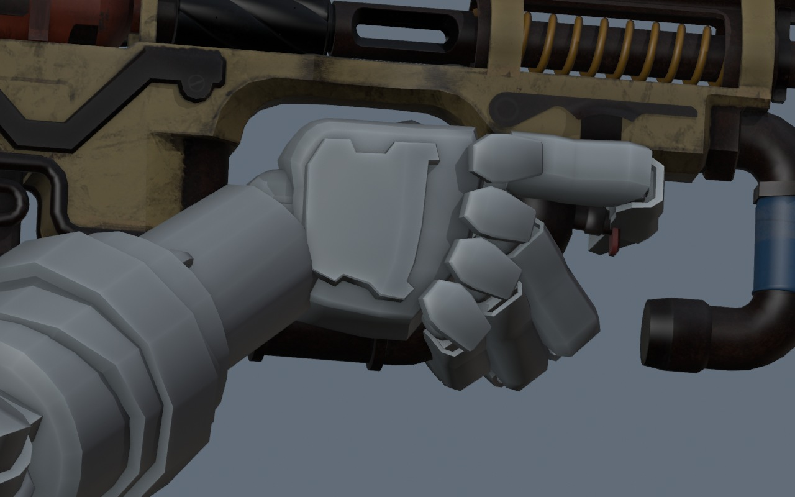
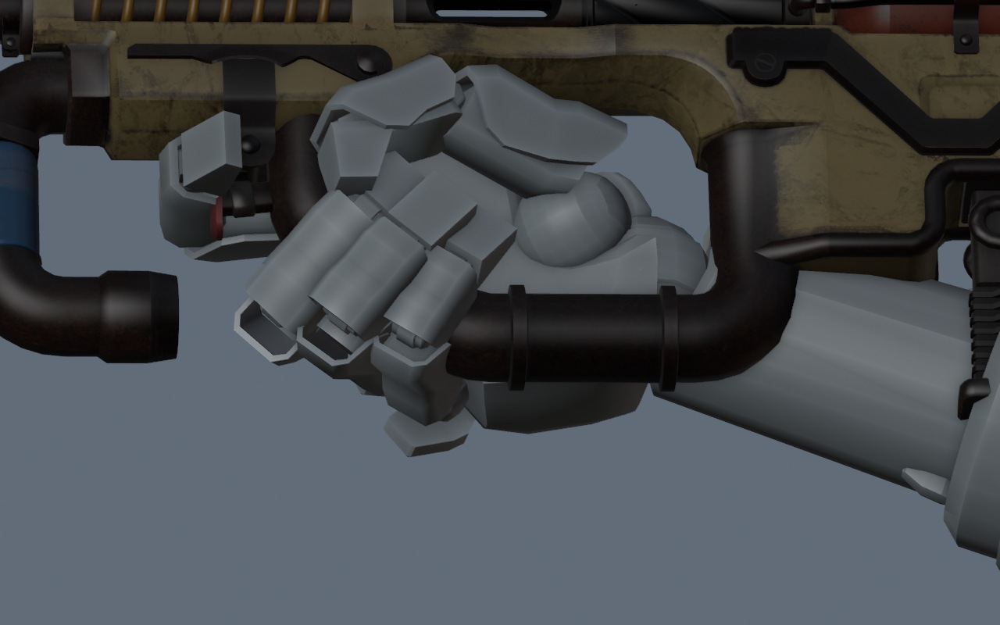
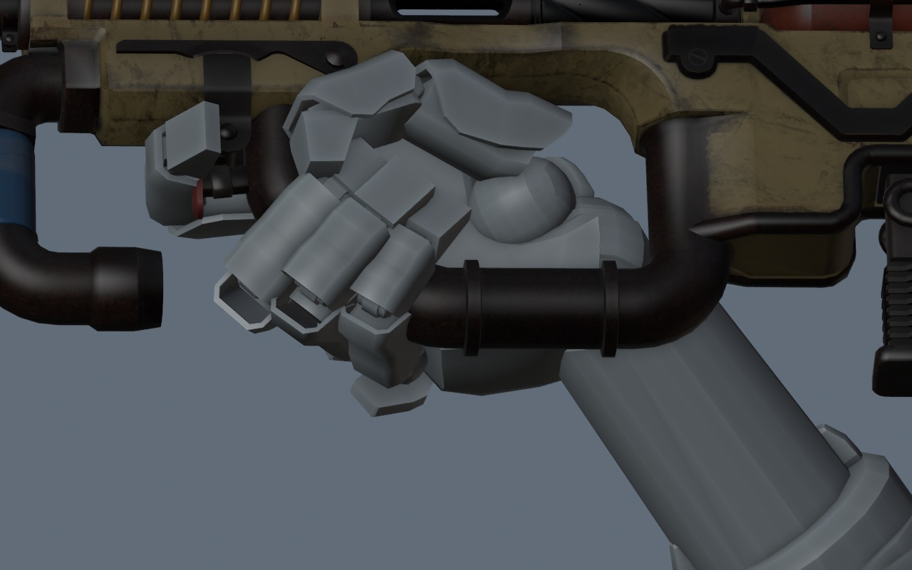
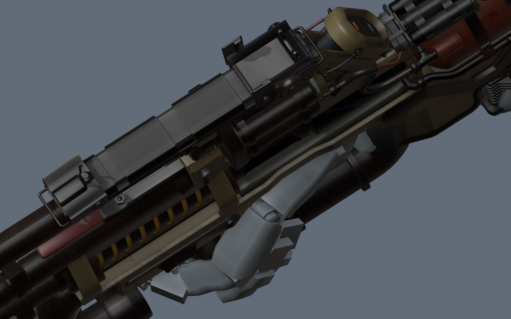
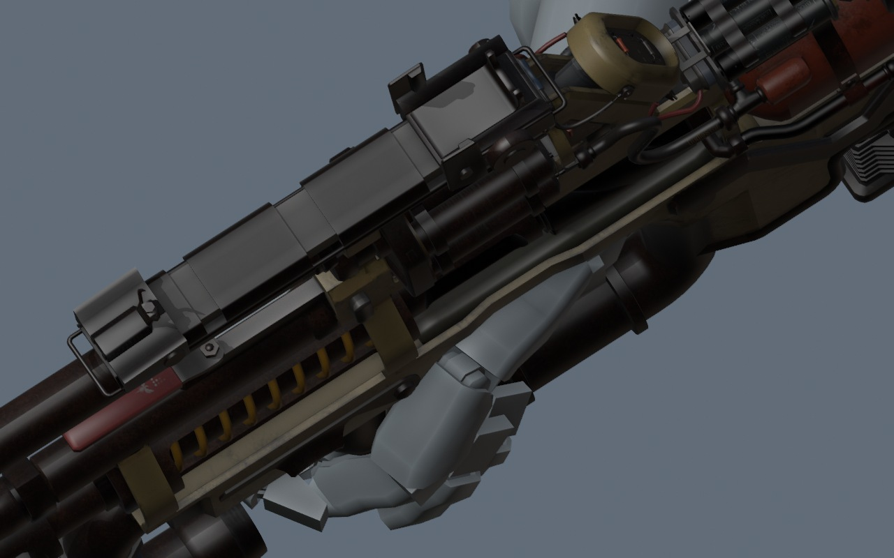
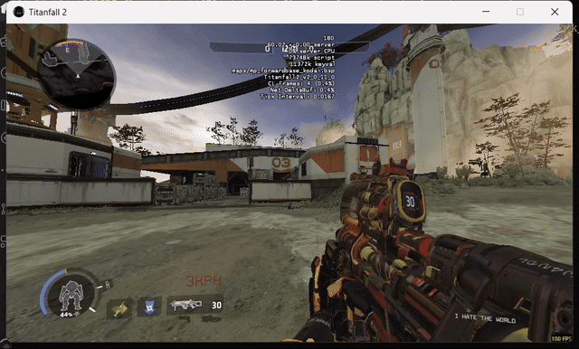
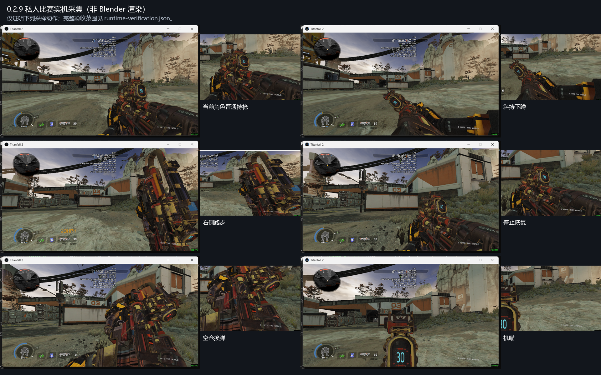

# 0.2.9 右手修正候选与对照

[下载候选安装包](https://github.com/ht1580/Prowler-CAR-Scavenger/releases/download/v0.2.9/Prowler.CAR.Scavenger-0.2.9.zip) · [下载全部图片与实机MP4](https://github.com/ht1580/Prowler-CAR-Scavenger/releases/download/v0.2.9/Prowler-Evidence-0.2.9.zip)

0.2.8被用户反馈右手各状态不自然。本轮定位到保持手腕接触点时，适配过程把右肘拉向中线、前臂拉直的问题。新候选保留原生右肘、前臂、手腕及手指目标，只适配上臂/锁骨。完整视觉接受仍待对照。

## 同机位前后对照（离线）

这次从实机预测第一人称代理读取并确认手臂为 `models/weapons/arms/pov_pilot_light_jester_f.mdl`。下图使用这套原始手臂，单独显示右手，左手已隐藏。中性灰用于结构检查，不模拟实机手套材质与屏幕UI。

前后切换GIF，同姿势结构对照，不是游戏动作：

| 0.2.8旧适配 | 0.2.9候选 |
|---|---|
|  |  |
|  |  |
|  |  |

## 实机跑步GIF

## 实机MP4

以下全部来自重启后的最终D轮进程23868、窗口私人比赛。被控制台遮挡和输入失效的早期记录已排除。视频没有音轨。

| 动作 | 视频 |
|---|---|
| 普通持枪 | [打开 / 下载MP4](https://github.com/ht1580/Prowler-CAR-Scavenger/releases/download/v0.2.9/standing.mp4) |
| 机瞄 | [打开 / 下载MP4](https://github.com/ht1580/Prowler-CAR-Scavenger/releases/download/v0.2.9/ads.mp4) |
| 下蹲斜持 | [打开 / 下载MP4](https://github.com/ht1580/Prowler-CAR-Scavenger/releases/download/v0.2.9/crouch.mp4) |
| 下蹲腰射与换弹 | [打开 / 下载MP4](https://github.com/ht1580/Prowler-CAR-Scavenger/releases/download/v0.2.9/crouch-fire-reload.mp4) |
| 右侧跑步 | [打开 / 下载MP4](https://github.com/ht1580/Prowler-CAR-Scavenger/releases/download/v0.2.9/sprint.mp4) |
| 停止恢复 | [打开 / 下载MP4](https://github.com/ht1580/Prowler-CAR-Scavenger/releases/download/v0.2.9/stop.mp4) |
| 空仓换弹 | [打开 / 下载MP4](https://github.com/ht1580/Prowler-CAR-Scavenger/releases/download/v0.2.9/empty-reload.mp4) |
| 中断换弹与切回 | [打开 / 下载MP4](https://github.com/ht1580/Prowler-CAR-Scavenger/releases/download/v0.2.9/interrupt-reload.mp4) |
| 切枪与移动 | [打开 / 下载MP4](https://github.com/ht1580/Prowler-CAR-Scavenger/releases/download/v0.2.9/run-equip.mp4) |
| 移动后恢复 | [打开 / 下载MP4](https://github.com/ht1580/Prowler-CAR-Scavenger/releases/download/v0.2.9/final-stop.mp4) |
| 手动换弹 | [打开 / 下载MP4](https://github.com/ht1580/Prowler-CAR-Scavenger/releases/download/v0.2.9/resume-manual.mp4) |
| 机瞄蹲起 | [打开 / 下载MP4](https://github.com/ht1580/Prowler-CAR-Scavenger/releases/download/v0.2.9/ads-crouch-exit.mp4) |
| 技能输入采样 | [打开 / 下载MP4](https://github.com/ht1580/Prowler-CAR-Scavenger/releases/download/v0.2.9/tactical.mp4) |
| 动作后静止 | [打开 / 下载MP4](https://github.com/ht1580/Prowler-CAR-Scavenger/releases/download/v0.2.9/idle-after.mp4) |

## 实机采样图

[右前臂网格核对](../../rebuild-zero/verification/0.2.9/right-forearm-validation.json) · [编译后逐帧核对](../../rebuild-zero/verification/0.2.9/compiled-dynamic-validation.json) · [完整实机范围](../../rebuild-zero/verification/0.2.9/runtime-verification.json)

源动作阶段的两套手臂网格检查与编译后的误差分别记录，不等于直接测得实机角度。手掌和手指仍保持原生抓握目标，没有把所有角色/技能组合和用户视觉评价宣称为全部通过。
